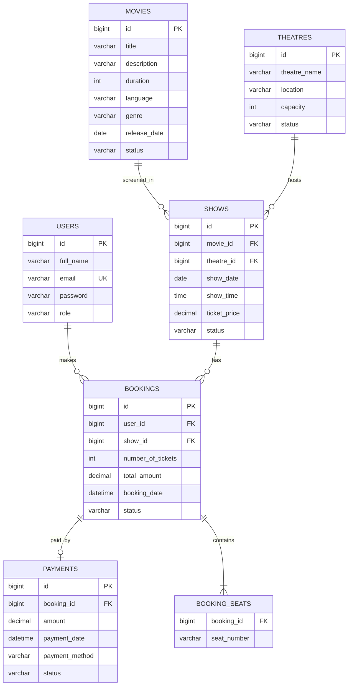

# Movie Ticket Booking System - Backend

Spring Boot + MySQL 
## Project Description

A backend REST API for an Online Movie Ticket Booking platform. Customers can browse movies, view shows, select seats, book tickets and make payments. Administrators can manage users, movies, theatres, shows, bookings and payments. The system is secured with Spring Security and JWT authentication.

## Technologies Used

- Java 25
- Spring Boot 4.1.1
- Spring Data JPA
- Spring Security with JWT
- MySQL
- Maven
- Git and GitHub
- Postman (API testing)

## Database Configuration

1. Install MySQL and create the database:

```sql
CREATE DATABASE movie_ticket_booking;
```

2. The application reads these values from environment variables:

| Variable | Description | Default |
|----------|-------------|---------|
| DB_URL | MySQL connection URL | jdbc:mysql://localhost:3306/movie_ticket_booking |
| DB_USERNAME | MySQL username | root |
| DB_PASSWORD | MySQL password | (set your own) |
| JWT_SECRET | Secret key used to sign JWT tokens | (set your own) |

3. Tables are created automatically because `spring.jpa.hibernate.ddl-auto=update` is set.
4. The server runs on port 8080.

## How to Run

1. Clone the repository:

```bash
git clone https://github.com/Ravindu-Kaushan/movie-ticket-booking-backend
```

2. Open the project in IntelliJ IDEA.
3. Open Run Configuration and set the environment variables:

```
DB_PASSWORD=your_mysql_password;JWT_SECRET=your_long_secret_key
```

4. Run the `MovieTicketBookingApplication` class.
5. The API will be available at `http://localhost:8080`.

Alternative (PowerShell):

```powershell
$env:DB_PASSWORD="your_mysql_password"
$env:JWT_SECRET="your_long_secret_key"
mvn spring-boot:run
``` 

## Entity Relationship Diagram (ERD)



## API Endpoints

### Authentication
| Method | Endpoint | Access | Description |
|--------|----------|--------|-------------|
| POST | /api/auth/signup | Public | Register a new customer |
| POST | /api/auth/signin | Public | Login and get JWT token |

### Users
| Method | Endpoint | Access | Description |
|--------|----------|--------|-------------|
| GET | /api/users | ADMIN | Get all users |
| GET | /api/users/{id} | ADMIN | Get user by ID |
| PUT | /api/users/{id} | ADMIN | Update user |
| DELETE | /api/users/{id} | ADMIN | Delete user |

### Movies
| Method | Endpoint | Access | Description |
|--------|----------|--------|-------------|
| GET | /api/movies | Public | Get all movies |
| GET | /api/movies/{id} | Public | Get movie by ID |
| POST | /api/movies | ADMIN | Create movie |
| PUT | /api/movies/{id} | ADMIN | Update movie |
| DELETE | /api/movies/{id} | ADMIN | Delete movie |

### Theatres
| Method | Endpoint | Access | Description |
|--------|----------|--------|-------------|
| GET | /api/theatres | Public | Get all theatres |
| GET | /api/theatres/{id} | Public | Get theatre by ID |
| POST | /api/theatres | ADMIN | Create theatre |
| PUT | /api/theatres/{id} | ADMIN | Update theatre |
| DELETE | /api/theatres/{id} | ADMIN | Delete theatre |

### Shows
| Method | Endpoint | Access | Description |
|--------|----------|--------|-------------|
| GET | /api/shows | Public | Get all shows |
| GET | /api/shows/{id} | Public | Get show by ID |
| GET | /api/shows/movie/{movieId} | Public | Get shows for a movie |
| GET | /api/shows/{id}/seats | Public | Get booked seats of a show |
| POST | /api/shows | ADMIN | Create show |
| PUT | /api/shows/{id} | ADMIN | Update show |
| DELETE | /api/shows/{id} | ADMIN | Delete show |

### Bookings
| Method | Endpoint | Access | Description |
|--------|----------|--------|-------------|
| POST | /api/bookings | Authenticated | Create booking |
| GET | /api/bookings/{id} | Owner or ADMIN | Get booking by ID |
| GET | /api/bookings/my-bookings | Authenticated | Get logged-in user's bookings |
| GET | /api/bookings | ADMIN | Get all bookings |
| PUT | /api/bookings/{id}/cancel | Authenticated | Cancel booking |
| PUT | /api/bookings/{id}/status?status=CONFIRMED | ADMIN | Update booking status |

### Payments
| Method | Endpoint | Access | Description |
|--------|----------|--------|-------------|
| POST | /api/payments | Authenticated | Create payment |
| PUT | /api/payments/{id}/process?success=true | Authenticated | Process payment (true = success, false = fail) |
| GET | /api/payments/{id} | Authenticated | Get payment details |
| GET | /api/payments/{id}/status | Authenticated | Check payment status |
| GET | /api/payments | ADMIN | Get all payments |

## Authentication Instructions

This project uses JWT (JSON Web Token) authentication with Spring Security.

1. Register a new account using `POST /api/auth/signup`. New accounts get the `CUSTOMER` role.
2. Login using `POST /api/auth/signin`. The response contains a `token`.
3. For every protected endpoint, add this header to the request:

```
Authorization: Bearer <your_token>
```

4. Public endpoints (signup, signin and all movie, theatre and show GET endpoints) do not need a token.

### Roles
- **ADMIN**: manage users, movies, theatres, shows, view all bookings, update booking status, view all payments.
- **CUSTOMER**: view movies, theatres and shows, view seat availability, create and cancel own bookings, make payments.

If the token is missing or invalid, the API returns `401 Unauthorized`. If the role is not allowed, it returns `403 Forbidden`.

## Sample API Requests

### Sign Up
`POST /api/auth/signup`
```json
{
  "fullName": "Nimal Perera",
  "email": "nimal@gmail.com",
  "password": "123456"
}
```

### Sign In
`POST /api/auth/signin`
```json
{
  "email": "nimal@gmail.com",
  "password": "123456"
}
```

Sample response:
```json
{
  "token": "eyJhbGciOiJIUzI1NiJ9...",
  "email": "nimal@gmail.com",
  "fullName": "Nimal Perera",
  "role": "CUSTOMER"
}
```

### Create Booking
`POST /api/bookings` (Bearer token required)
```json
{
  "showId": 1,
  "seatNumbers": ["D1", "D2"],
  "numberOfTickets": 2
}
```

### Create Payment
`POST /api/payments` (Bearer token required)
```json
{
  "bookingId": 1,
  "paymentMethod": "CARD"
}
```

### Process Payment
`PUT /api/payments/1/process?success=true` (Bearer token required, no body)

## Future Expansion Proposal

### 1. Discount and Promo Code System

**Proposed feature:** Customers can enter a promo code (for example `MOVIE10`) when booking tickets, and the system reduces the total amount by a percentage or a fixed value.

**Why it is useful:** Promo codes attract more customers, help the theatre run offers on slow days, and give admins control over marketing campaigns.

**Existing entities affected:**
- `Booking`: needs a new field for the discount amount, and a link to the promo code used. The total amount calculation changes to: ticket price x tickets - discount.
- `Payment`: the payment amount will use the discounted total.

**New entities required:** Yes, a new `PromoCode` entity (id, code, discountType, discountValue, expiryDate, usageLimit, status).

**Database relationship extension:**
- `PromoCode` 1:M `Booking` (one promo code can be used in many bookings, each booking uses at most one promo code).
- A new foreign key column `promo_code_id` is added to the `bookings` table.

### 2. Movie Reviews and Ratings

**Proposed feature:** Customers who have a CONFIRMED booking for a movie can give a star rating (1 to 5) and write a review. The movie page shows the average rating.

**Why it is useful:** Reviews help other customers choose a movie, and increase user engagement. Only customers with a confirmed booking can review, so the reviews are genuine.

**Existing entities affected:**
- `Movie`: can store an average rating, or the average can be calculated from reviews.
- `User`: a user can write many reviews.

**New entities required:** Yes, a new `Review` entity (id, rating, comment, reviewDate).

**Database relationship extension:**
- `User` 1:M `Review` (a user writes many reviews).
- `Movie` 1:M `Review` (a movie has many reviews).
- The `reviews` table has two foreign keys: `user_id` and `movie_id`.
- A unique constraint on (`user_id`, `movie_id`) so one user can review a movie only once.

## Repository Submission

The source code is hosted on GitHub. The repository contains `README.md`, `.gitignore` and `pom.xml`.

Repository URL: https://github.com/Ravindu-Kaushan/movie-ticket-booking-backend

Submission process:
1. Initialize Git in the project folder and commit the code (`git init`, `git add .`, `git commit`).
2. Create a public repository on GitHub and add it as the remote (`git remote add origin <url>`).
3. Push the code to the `main` branch (`git push`).
4. Submit the repository URL.